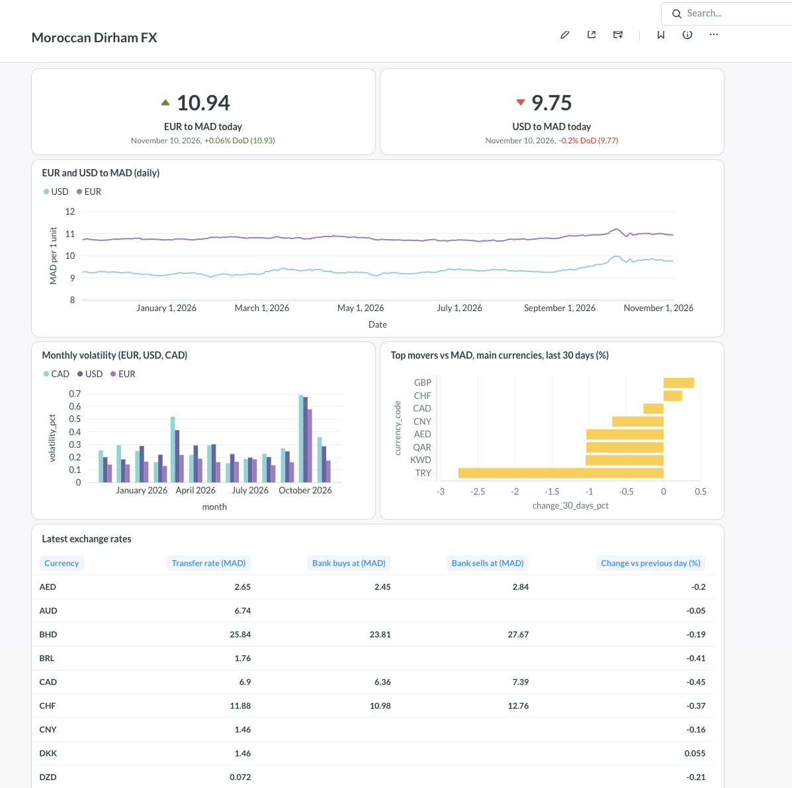
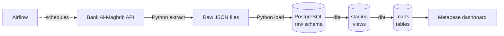

# Moroccan Dirham FX Pipeline

Automated data pipeline that collects the official daily exchange rates
of the Moroccan dirham (MAD) from the **Bank Al-Maghrib API**, stores them
in PostgreSQL, cleans and tests them with **dbt**, and serves them to a
**Metabase** dashboard. Orchestrated daily with **Apache Airflow**,
fully containerized with **Docker**.



## Architecture



## Tech stack

| Layer          | Tools                                  |
| -------------- | -------------------------------------- |
| Ingestion      | Python, requests                       |
| Storage        | PostgreSQL 16 (raw data kept as JSONB) |
| Transformation | dbt Core, dbt_utils                    |
| Orchestration  | Apache Airflow 3                       |
| Visualization  | Metabase                               |
| Infrastructure | Docker, Docker Compose                 |

## Data

- **Source:** [Bank Al-Maghrib developer API](https://apihelpdesk.centralbankofmorocco.ma/)
- **Transfer rates** (`CoursVirement`): 30 currencies, daily mid rate
- **Banknote rates** (`CoursBBE`): 13 currencies, buy and sell prices
- Published on Moroccan business days only (no weekends or public holidays)

## Pipeline design

- **Idempotent:** re-running any day gives the same result
  (files already downloaded are skipped, database rows are replaced)
- **Rate-limit aware:** waits between API calls and retries on HTTP 429
- **Late data:** each daily run re-checks the last 7 days
- **Raw data kept as received:** cleaning happens in dbt, so the source
  can always be re-processed

## Data quality

20+ dbt tests run on every build, including:

- No duplicate currency per day
- No missing rates
- Rates always above 0
- Bank sell price never below its buy price
- Source freshness: warning if no new data for 2 days

The tests caught a real issue: the API sometimes returns the same
currency twice for a day. Duplicates are removed in the staging layer.

## dbt models

| Model                        | Type  | Description                              |
| ---------------------------- | ----- | ---------------------------------------- |
| `stg_bam__transfer_rates`    | view  | Typed transfer rates, per-unit rates     |
| `stg_bam__banknote_rates`    | view  | Deduplicated buy/sell rates, bank spread |
| `fct_exchange_rates_daily`   | table | Daily rates + day-over-day change        |
| `agg_exchange_rates_monthly` | table | Monthly average, min, max, volatility    |

## Project structure

```
├── airflow/             Airflow image and DAG
├── ingestion/           API client and extraction (raw JSON files)
├── loading/             Loads raw files into PostgreSQL
├── sql/                 Raw table definitions
├── transform/           dbt project (staging and marts models, tests)
└── docker-compose.yml   PostgreSQL, Airflow, Metabase
```

## Run it locally

1. Get a free API key on the
   [Bank Al-Maghrib portal](https://apihelpdesk.centralbankofmorocco.ma/)
   (product: _Marché des changes_)
2. Create a `.env` file:

   ```
   BAM_API_KEY=your_key
   POSTGRES_USER=pipeline
   POSTGRES_PASSWORD=your_password
   POSTGRES_DB=morocco_market
   POSTGRES_HOST=localhost
   POSTGRES_PORT=5433
   ```

3. Start everything:

   ```bash
   docker compose up -d --build
   ```

4. Open:
   - Airflow: http://localhost:8080
   - Metabase: http://localhost:3000

## Roadmap

- [ ] Deploy on Azure
- [ ] CI/CD with GitHub Actions (lint, tests, dbt build)
